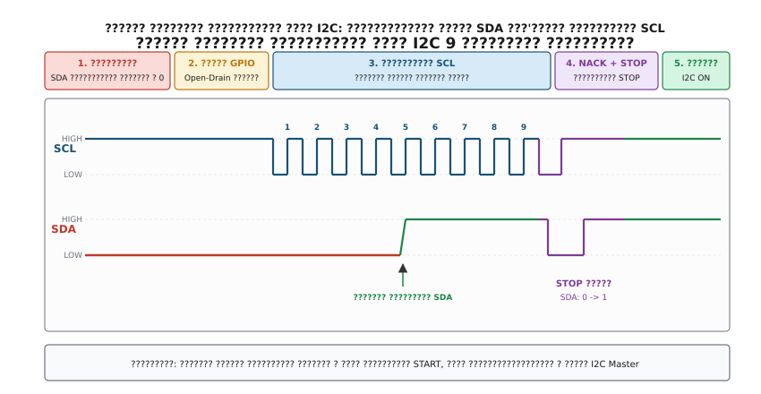

## Апаратне відновлення шини I2C: протокол 9 тактових імпульсів

Коли таймаут очікування завершення транзакції I2C вичерпано і діагностика фіксує стан `SDA = 0` при високому рівні SCL, просте програмне скидання апаратного периферійного блока мікроконтролера через регістр `I2C1->CR1 |= I2C_CR1_SWRST` не здатне відновити працездатність шини. Проблема криється у фізичному стані веденого пристрою: N-канальний польовий транзистор на виході веденого чипа продовжує замикати лінію даних на землю.

Для безпечного електричного розблокування шини I2C розроблено стандартизований апаратно-програмний алгоритм — **процедуру ручного тактування дев'ятьма імпульсами (I2C Bus Recovery Routine)**.


*Часова діаграма примусового розблокування лінії SDA за допомогою перемикання виводів у режим GPIO Open-Drain, генерації 9 імпульсів SCL та формування умов NACK і STOP.*

### Фізична сутність та покроковий алгоритм відновлення

Причина, через яку ведений чип утримує лінію SDA у низькому логічному рівні, полягає в тому, що його внутрішній цифровий кінцевий автомат (FSM) перебуває посеред циклу передачі байта. Якщо переданий біт дорівнює 0, ведений відкриває свій вихідний N-MOSFET. Щоб перейти до наступного біта або завершити транзакцію, цифровому автомату веденого чипа потрібен черговий спадний фронт на вході тактування SCL.

Оскільки апаратний контролер I2C мікроконтролера блокується при виявленні `SDA = 0` і відмовляється формувати тактові імпульси, ведучий процесор зобов'язаний тимчасово взяти керування лініями SCL та SDA на себе в режимі прямого маніпулювання виводами (Bit-Banging).

Алгоритм виконується за такі сім послідовних етапів:

1. **Вимкнення та ізоляція апаратного модуля I2C**.
   Процесор скидає біт увімкнення периферії `PE` (Peripheral Enable) у керуючому регістрі `I2C_CR1`. Це від'єднує внутрішні цифрові вузли апаратного контролера I2C від фізичних контактів корпусу мікроконтролера, переводячи виводи в стан під керуванням контролера GPIO.
2. **Переконфігурація виводів SCL та SDA в режим GPIO Open-Drain**.
   Виводи мікроконтролера перемикаються з альтернативної функції (Alternate Function, AF4 у STM32) у режим виходів загального призначення (General Purpose Output) типу відкритий стік (Open-Drain). Обидва виводи переводяться у високий логічний стан (запис 1 у регістр `BSRR`), що закриває вихідні транзистори мікроконтролера й дозволяє зовнішнім підтягувальним резисторам $R_{\text{pull-up}}$ підтягнути лінії до $V_{\text{DD}}$.
3. **Попереднє діагностичне опитування лінії SDA**.
   Процесор виконує затримку $10\,\mu\text{s}$ для завершення перехідних процесів заряду ємності шини, після чого зчитує логічний стан лінії SDA через регістр вхідних даних `GPIO_IDR`:
   - Якщо `SDA == 1` (HIGH), лінія даних вільна. Зависання було спричинене збоєм самого контролера I2C ведучого, а не веденим чипом. Процесор може пропустити фазу тактування та перейти безпосередньо до генерації умови STOP.
   - Якщо `SDA == 0` (LOW), ведений чип утримує лінію. Необхідно виконати примусове тактування лінії SCL.
4. **Генерація серії до 9 тактових імпульсів на лінії SCL**.
   Процесор програмно формує на виводі SCL послідовність прямокутних імпульсів, що відповідають часовим характеристикам режиму Standard Mode ($100\,\text{kHz}$):
   - Опустити лінію SCL у логічний нуль ($0.0\,\text{V}$), записавши біт у молодшу або старшу половину регістра `BSRR`.
   - Витримати час низького рівня $t_{\text{LOW}} \ge 4.7\,\mu\text{s}$ (за стандартом I2C).
   - Підняти лінію SCL у логічну одиницю ($3.3\,\text{V}$).
   - Витримати час високого рівня $t_{\text{HIGH}} \ge 4.0\,\mu\text{s}$.
   - Під час високого рівня SCL зчитати стан лінії SDA через регістр `GPIO_IDR`.
   - **Чому саме 9 імпульсів?** Максимальна довжина будь-якого неподільного блоку передачі в протоколі I2C становить 8 бітів даних плюс 1 біт підтвердження ACK/NACK. Навіть якщо транзакцію було перервано на першому біті, веденому чипу знадобиться щонайбільше 8 тактів SCL, щоб виштовхнути залишок бітів зі свого зсувного регістра, та 1 такт для переходу у фазу очікування ACK. Як тільки останній нульовий біт залишає регістр зсуву, ведений закриває свій вихідний N-MOSFET, і лінія SDA під дією підтягувального резистора піднімається у високий рівень $3.3\,\text{V}$.
   - Якщо на черговому такті зчитано `SDA == 1`, цикл генерації імпульсів можна перервати достроково.
5. **Генерація умови NACK (Not Acknowledge)**.
   Під час дев'ятого тактового імпульсу ведучий контролер утримує власну лінію SDA у високому стані (HIGH). Для веденого пристрою це є сигналом NACK — повідомленням про те, що ведучий відмовляється від прийому подальших даних. Отримавши NACK, ведений чип гарантовано припиняє передачу і переводить свій внутрішній інтерфейсний автомат у стан очікування умови STOP.
6. **Генерація примусової умови STOP**.
   Після того як ведений відпустив лінію SDA і обидві лінії повернулися у високий рівень, ведучий зобов'язаний сформувати коректну умову зупинки STOP (перехід лінії SDA з низького рівня на високий при збереженні високого рівня на лінії SCL):
   - Опустити лінію SDA в 0 при високому або низькому SCL.
   - Підняти лінію SCL у 1 і витримати час встановлення $t_{\text{SU;STO}} \ge 4.0\,\mu\text{s}$.
   - Підняти лінію SDA в 1 при утриманні SCL у високому рівні.
   - Витримати час вільного стану шини перед наступною транзакцією $t_{\text{BUF}} \ge 4.7\,\mu\text{s}$.
   - Умова STOP є глобальним апаратним скиданням для всіх мікросхем, підключених до даної шини I2C: вона повертає всі внутрішні лічильники байтів і адресні декодери у стан спокою (Bus Idle).
7. **Апаратне скидання та повернення периферійного блока I2C**.
   - Виводи мікроконтролера повертаються в режим альтернативної функції (Alternate Function AF4).
   - Для усунення можливих зависань внутрішніх тригерів самого мікроконтролера виконується апаратне скидання модуля I2C: встановлюється біт `SWRST` у регістрі `I2C_CR1`, витримується пауза $5\,\mu\text{s}$, після чого біт `SWRST` очищується.
   - Виконується стандартна конфігурація регістрів частоти (`I2C_CR2`, `I2C_CCR`, `I2C_TRISE`) та повторне ввімкнення модуля бітом `I2C_CR1_PE = 1`.

### Крайові випадки та апаратні пастки відновлення шини

Під час реалізації процедури відновлення шини інженер стикається з трьома критичними крайовими випадками:

1. **Коротке замикання лінії SDA на землю (Hard Ground Short)**. Якщо після подачі всіх 9 тактових імпульсів лінія SDA залишається притиснутою до $0.0\,\text{V}$, це вказує або на фізичне коротке замикання на друкованій платі (металевий задирок, дефект пайки), або на внутрішній електричний пробій вихідного каскаду одного з чипів на шині. Функція розблокування зобов'язана перевірити стан SDA після завершення циклу і повернути фатальну помилку `BUS_ERR_STUCK`, не дозволяючи системі повторювати марні спроби.
2. **Зависання лінії SCL на рівні нуля (Clock Stretching Deadlock)**. Якщо ведений чип з функцією розтягування тактування зазнав внутрішнього апаратного колапсу і притиснув лінію SCL до землі, мікроконтролер у режимі Open-Drain не зможе підняти SCL у високий рівень. Драйвер відновлення повинен контролювати стан лінії SCL після переведення її у високий рівень: якщо через $10\,\mu\text{s}$ SCL залишається в нулі, це свідчить про апаратний клінч веденого чипа, який не лікується тактуванням і вимагає негайного переходу до ескалації скидання живленням (Tier 3).
3. **Мультимайстерні колізії (Multi-Master Arbitration)**. У системах із кількома ведучими мікроконтролерами на одній шині генерація 9 тактів повинна супроводжуватися перевіркою, чи не почав інший ведучий паралельну транзакцію. Якщо під час високого рівня SCL лінія SDA несподівано змінює стан, функція повинна зафіксувати втрату арбітражу (`ArbitrationLost`).

### Програмна реалізація модуля відновлення I2C на C99 та C++20

:::tabs
@tab C99
```c
#include <stdint.h>
#include <stdbool.h>
#include "stm32f4xx.h"

static void delay_dwt_us(uint32_t us) {
    uint32_t start = DWT->CYCCNT;
    uint32_t ticks = (uint32_t)(((uint64_t)us * SystemCoreClock) / 1000000ULL);
    while ((uint32_t)(DWT->CYCCNT - start) < ticks);
}

int i2c_bus_recover_9_pulses(GPIO_TypeDef *scl_port, uint16_t scl_pin,
                             GPIO_TypeDef *sda_port, uint16_t sda_pin,
                             I2C_TypeDef *i2c) {
    // 1. Вимикаємо периферійний модуль I2C
    i2c->CR1 &= ~I2C_CR1_PE;

    // 2. Налаштовуємо виводи SCL та SDA як GPIO Open-Drain Output
    scl_port->BSRR = (1U << scl_pin);
    sda_port->BSRR = (1U << sda_pin);

    // SCL -> Output Open-Drain
    scl_port->MODER &= ~(3U << (scl_pin * 2));
    scl_port->MODER |= (1U << (scl_pin * 2));
    scl_port->OTYPER |= (1U << scl_pin);
    scl_port->OSPEEDR |= (3U << (scl_pin * 2)); // High speed

    // SDA -> Output Open-Drain
    sda_port->MODER &= ~(3U << (sda_pin * 2));
    sda_port->MODER |= (1U << (sda_pin * 2));
    sda_port->OTYPER |= (1U << sda_pin);
    sda_port->OSPEEDR |= (3U << (sda_pin * 2));

    delay_dwt_us(10);

    // 3. Перевіряємо, чи не затиснута лінія SCL веденим чипом
    if ((scl_port->IDR & (1U << scl_pin)) == 0) {
        return -2; // SCL stuck low: Clock stretching failure
    }

    // 4. Генеруємо до 9 тактових імпульсів на SCL
    bool sda_freed = false;
    for (int i = 0; i < 9; i++) {
        // Якщо SDA вже відпущено веденим, виходимо
        if ((sda_port->IDR & (1U << sda_pin)) != 0) {
            sda_freed = true;
            break;
        }

        // SCL = 0 (Low)
        scl_port->BSRR = (1U << (scl_pin + 16));
        delay_dwt_us(5); // t_LOW >= 4.7 us

        // SCL = 1 (High)
        scl_port->BSRR = (1U << scl_pin);
        delay_dwt_us(5); // t_HIGH >= 4.0 us
    }

    if ((sda_port->IDR & (1U << sda_pin)) != 0) {
        sda_freed = true;
    }

    // 5. Формуємо примусову умову STOP: SDA 0 -> 1 при SCL = 1
    sda_port->BSRR = (1U << (sda_pin + 16)); // SDA = 0
    delay_dwt_us(5);
    scl_port->BSRR = (1U << scl_pin);        // SCL = 1
    delay_dwt_us(5);
    sda_port->BSRR = (1U << sda_pin);        // SDA = 1 (STOP фронт)
    delay_dwt_us(10);

    // 6. Повертаємо виводи в режим альтернативної функції I2C (AF4)
    scl_port->MODER &= ~(3U << (scl_pin * 2));
    scl_port->MODER |= (2U << (scl_pin * 2)); // AF mode
    sda_port->MODER &= ~(3U << (sda_pin * 2));
    sda_port->MODER |= (2U << (sda_pin * 2)); // AF mode

    // 7. Скидаємо та переініціалізуємо апаратний модуль I2C
    i2c->CR1 |= I2C_CR1_SWRST;
    delay_dwt_us(5);
    i2c->CR1 &= ~I2C_CR1_SWRST;
    i2c->CR1 |= I2C_CR1_PE;

    return sda_freed ? 0 : -1;
}
```
@tab C++20
```cpp
#include <cstdint>
#include <chrono>
#include <expected>
#include "stm32f4xx.h"

struct BusPin {
    GPIO_TypeDef* port;
    uint8_t pin;

    void set_high() const noexcept { port->BSRR = (1U << pin); }
    void set_low() const noexcept { port->BSRR = (1U << (pin + 16)); }
    [[nodiscard]] bool read() const noexcept { return (port->IDR & (1U << pin)) != 0; }

    void configure_open_drain() const noexcept {
        port->MODER &= ~(3U << (pin * 2));
        port->MODER |= (1U << (pin * 2)); // Output mode
        port->OTYPER |= (1U << pin);      // Open-drain
        port->OSPEEDR |= (3U << (pin * 2));
    }

    void configure_alternate_function() const noexcept {
        port->MODER &= ~(3U << (pin * 2));
        port->MODER |= (2U << (pin * 2)); // AF mode
    }
};

class I2cRecoveryEngine {
public:
    static std::expected<void, BusError> recover(BusPin scl, BusPin sda, I2C_TypeDef* i2c) noexcept {
        i2c->CR1 &= ~I2C_CR1_PE; // Вимикаємо периферію

        scl.set_high();
        sda.set_high();
        scl.configure_open_drain();
        sda.configure_open_drain();

        delay_us(10);

        // Перевірка стану лінії SCL
        if (!scl.read()) {
            return std::unexpected(BusError::BusStuck);
        }

        bool freed = false;
        for (int pulse = 0; pulse < 9; ++pulse) {
            if (sda.read()) {
                freed = true;
                break;
            }
            scl.set_low();
            delay_us(5);
            scl.set_high();
            delay_us(5);
        }

        if (sda.read()) {
            freed = true;
        }

        // Примусова умова STOP
        sda.set_low();
        delay_us(5);
        scl.set_high();
        delay_us(5);
        sda.set_high();
        delay_us(10);

        // Відновлення режимів пінів
        scl.configure_alternate_function();
        sda.configure_alternate_function();

        // Скидання модуля
        i2c->CR1 |= I2C_CR1_SWRST;
        delay_us(5);
        i2c->CR1 &= ~I2C_CR1_SWRST;
        i2c->CR1 |= I2C_CR1_PE;

        if (!freed) {
            return std::unexpected(BusError::BusStuck);
        }
        return {};
    }

private:
    static void delay_us(uint32_t us) noexcept {
        const uint32_t start = DWT->CYCCNT;
        const uint32_t ticks = static_cast<uint32_t>((static_cast<uint64_t>(us) * SystemCoreClock) / 1'000'000ULL);
        while ((DWT->CYCCNT - start) < ticks);
    }
};
```
:::
