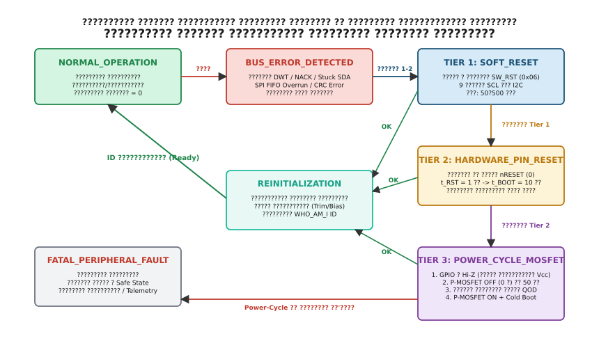

## Трирівнева ескалація скидання чипа: від софтверного регістра до скидання живлення

Процедура дев'яти тактових імпульсів ефективно вирішує проблему електричного блокування ліній зв'язку, але вона безсила, якщо у веденого чипа зазнало внутрішнього апаратного збою цифрове ядро, збився фазоінверсний помножувач частоти (PLL), завис інтегрований сигма-дельта АЦП або пошкодилася внутрішня пам'ять конфігураційних регістрів через високовольтну заваду.

Для побудови відмовостійкої системи впроваджують **стратегію трирівневої ескалації скидання (Three-Tier Reset Escalation Strategy)**.


*Скінченний автомат обробки відмов периферійного пристрою: від програмного скидання командним регістром до апаратного імпульсу nRESET та повного циклічного відключення живлення комутатором MOSFET.*

Ескалація базується на принципі мінімально необхідного втручання: система спочатку випробовує найшвидший і найменш ресурсомісткий спосіб відновлення, і лише при повторенні відмови переходить на наступний, більш радикальний рівень.

### Рівень 1 (Tier 1): Програмне скидання через регістри (Soft-Reset)

Перший рівень захисту полягає у відправленні цифрової команди скидання по штатній шині зв'язку (I2C або SPI) без комутації фізичних виводів живлення.

* **Команда загального виклику I2C General Call Software Reset**. Офіційна специфікація I2C виділяє адресу `0x00` як адресу загального виклику (General Call Address). Якщо ведучий передає за адресою `0x00` другий байт зі значенням `0x06`, усі підключені до шини мікросхеми, що підтримують стандартний режим General Call (більшість сенсорів NXP, Texas Instruments, STMicroelectronics), зобов'язані перезавантажити свій внутрішній регістровий блок у значення за замовчуванням (Default Reset State).
* **Спеціалізовані регістри програмного скидання чипів**. Майже кожен сучасний цифровий датчик містить виділений командний регістр для скидання логіки:
  - Датчики Bosch Sensortec (барометри BMP280/BMP388, сенсори BME680, IMU BNO055): запис байта `0xB6` у регістр `RESET` (`0xE0` або `0x7E`).
  - Акселерометри та гіроскопи STMicroelectronics (LIS3DH, LSM6DSO): встановлення біта `SW_RESET` у керуючому регістрі `CTRL_REG` або біта `BOOT` для примусового перезавантаження калібрувальних коефіцієнтів з OTP-пам'яті.
  - Сенсори TDK InvenSense (MPU6050, ICM42688): запис біта `DEVICE_RESET` (біт 7) у регістрі `PWR_MGMT_1` (`0x6B`).

**Переваги**: надзвичайно висока швидкість виконання (від $50\,\mu\text{s}$ до $1\,\text{ms}$), повна відсутність комутаційних перехідних процесів на шинах живлення, безпека для сусідніх пристроїв на спільній шині.

**Обмеження**: рівень Tier 1 повністю недієздатний, якщо в чипа завис власний тактовий генератор, пошкоджено блок інтерфейсного автомата або лінія зв'язку залишається електрично заблокованою, оскільки в такому стані мікросхема фізично не здатна прийняти та декодувати команду скидання.

### Рівень 2 (Tier 2): Апаратне скидання виділеною лінією nRESET (Hardware Pin Reset)

Якщо 1–2 спроби програмного скидання не дали результату (чип повертає NACK або зчитаний ідентифікатор пристрою `WHO_AM_I` не збігається з очікуваним еталоном), система активує виділену лінію апаратного скидання `nRESET` (NRST).

Вивід `nRESET` підключається до окремого виводу GPIO мікроконтролера, налаштованого як двотактний вихід (Push-Pull). У нормальному робочому режимі мікроконтролер утримує на цій лінії високий логічний рівень $3.3\,\text{V}$.

Послідовність виконання апаратного скидання:

1. Процесор опускає вивід `nRESET` у логічний нуль ($0.0\,\text{V}$).
2. Процесор витримує нормовану тривалість імпульсу скидання $t_{\text{RST}}$, зазначену в технічній документації на чип. Зазвичай мінімальна тривалість становить від $10\,\mu\text{s}$ (для простих цифрових мікросхем) до $1\text{--}5\,\text{ms}$ (для складних SoC або вимірювальних мостів).
3. Процесор повертає лінію `nRESET` у високий рівень $3.3\,\text{V}$.
4. Витримується інтервал запуску внутрішньої схеми Power-On Reset та стабілізації аналогових вузлів $t_{\text{BOOT}}$ / $t_{\text{POR}}$ (Power-On Reset settling time). Протягом цього інтервалу (від $500\,\mu\text{s}$ до $20\text{--}50\,\text{ms}$) чип перезапускає внутрішній RC-генератор, виконує стабілізацію напруг внутрішнього LDO-регулятора ядра ($1.2\,\text{V}$ або $1.8\,\text{V}$) та автоматично перезавантажує заводські калібрувальні коефіцієнти (Trim/Bias) з енергонезалежної OTP/ROM-пам'яті у відповідні регістри.

**Переваги**: гарантоване скидання всіх цифрових кінцевих автоматів, тригерів і регістрів мікросхеми до заводського стану без відключення силового живлення.

**Обмеження**: вимагає виділення додаткового виводу мікроконтролера для кожного зовнішнього чипа. Крім того, апаратне скидання виводом nRESET не здатне вивести мікросхему зі стану тиристорного замикання (CMOS Latch-up), спричиненого високовольтним імпульсом ESD або перенапругою на входах, коли паразитна чотиришарова структура P-N-P-N залишається у відкритому стані й закорочує шину живлення на землю до повного зняття напруги.

### Рівень 3 (Tier 3): Повне циклічне скидання живлення шини (Power-Cycle MOSFET / Load Switch)

Коли вичерпано можливості програмного скидання та апаратного виводу nRESET, останнім надійним рубежем відновлення є повне фізичне знеструмлення периферійного вузла — процедура **Power-Cycle**.

Комутація живлення здійснюється за допомогою силового P-канального польового транзистора (High-Side P-MOSFET) або спеціалізованої інтегральної мікросхеми комутації навантаження (Load Switch, наприклад Texas Instruments TPS22918, TPS22919).

#### Фізика та критична небезпека паразитного живлення через діоди захисту ESD (Phantom Back-Powering)

Найбільш небезпечною помилкою під час проектування схем керування живленням периферії є спроба вимкнути комутуючий транзистор живлення, залишивши цифрові лінії зв'язку мікроконтролера в активному стані.

Кожен вхід/вихід цифрової мікросхеми містить внутрішню схему захисту від електростатичного розряду (ESD Protection), яка складається з двох захисних діодів:
- Нижній діод $D_{\text{ESD\_BOTTOM}}$ підключений катодом до виводу мікросхеми, а анодом — до внутрішньої землі GND.
- Верхній діод $D_{\text{ESD\_TOP}}$ підключений анодом до виводу мікросхеми, а катодом — до внутрішньої шини живлення $V_{\text{DD\_CHIP}}$.

```
                     V_DD_CHIP (Switched Rail)
                         │
                         ▲
                        / \  D_ESD_TOP
                       ─────
                         │
      MCU_GPIO ──────────┴────────── Chip Internal Logic
                         │
                         ▲
                        / \  D_ESD_BOTTOM
                       ─────
                         │
                        GND
```

Якщо керуючий P-MOSFET розмикає коло живлення ($V_{\text{EXT\_BUS}} = 0\,\text{V}$), але мікроконтролер продовжує утримувати хоча б одну лінію зв'язку (SCL, SDA, CS, MOSI, SCK, nRESET) у високому рівні $3.3\,\text{V}$, виникає явище **паразитного зворотного живлення (Phantom Back-Powering)**:

1. Напруга $3.3\,\text{V}$ з виводу мікроконтролера виявляється вищою за напругу на знеструмленій шині живлення сенсора.
2. Верхній захисний діод $D_{\text{ESD\_TOP}}$ всередині сенсора зміщується у прямому напрямку при перевищенні порогу відмикання $V_{\text{F}} \approx 0.6\,\text{V}$.
3. Струм із вихідного драйвера мікроконтролера або через підтягувальний резистор $R_{\text{pull-up}}$ потече через діод $D_{\text{ESD\_TOP}}$ безпосередньо у внутрішню шину живлення $V_{\text{DD\_CHIP}}$, заряджаючи блокувальні конденсатори сенсора.
4. Напруга на внутрішній шині живлення сенсора встановлюється на рівні:

$$V_{\text{DD\_CHIP}} = V_{\text{MCU\_IO}} - V_{\text{F}} = 3.3\,\text{V} - 0.6\,\text{V} = 2.7\,\text{V}$$

У результаті сенсор **взагалі не знеструмлюється**. Він продовжує функціонувати в аварійному режимі глибокого просідання напруги ($2.7\,\text{V}$ замість номінальних $3.3\,\text{V}$), його внутрішній супервізор живлення POR не фіксує падіння нижче порогу скидання ($1.4\text{--}1.8\,\text{V}$), а струм, що протікає через мініатюрний захисний діод ESD (до 20–50 мА), викликає його локальний перегрів, деградацію P-N переходу та ризик теплового пробою.

#### Суворий регламент процедури циклічного скидання живлення

Щоб гарантувати 100% знеструмлення та відновлення периферійного чипа, процедура Power-Cycle повинна суворо дотримуватися такого алгоритму:

1. **Повна ізоляція інтерфейсу (Tri-state / Hi-Z isolation)**:
   - До зняття напруги живлення абсолютно всі виводи мікроконтролера, електрично підключені до цільового чипа (SCL, SDA, CS, MOSI, MISO, SCK, nRESET, INT), переводяться в режим аналогових входів (Analog Mode, `MODER = 0b11`). У цьому режимі вихідні транзистори мікроконтролера повністю відключені, вхідні буфери Шмітта знеструмлені, а вивід переходить у стан високого імпедансу (Hi-Z) зі струмом витоку менше $1\,\text{nA}$.
   - Всі внутрішні підтягувальні резистори вимикаються (`PUPDR = 0b00`).
   - Якщо на друкованій платі встановлені зовнішні підтягувальні резистори для шини I2C, їхній верхній вивід повинен живитися від комутованої шини $V_{\text{SENSOR}}$, а не від постійної шини $3.3\,\text{V}$.
2. **Розмикання силового ключа (Power Cut)**:
   - Процесор закриває комутуючий P-MOSFET (подає високий рівень на затвор через схему розгойдування або скидає сигнал Enable на мікросхемі Load Switch).
3. **Примусовий розряд залишкової ємності (Active Discharge)**:
   - Блокувальні керамічні та танталові конденсатори шини живлення ($C_{\text{decoupling}} = 10\text{--}47\,\mu\text{F}$) мають розрядитися до залишкової напруги нижче за $0.05\,\text{V}$.
   - Якщо навантаження відключене, струм споживання падає до мікроампер, і саморозряд через струми витоку діелектрика може тривати десятки секунд. Для гарантованого швидкого розряду на комутовану шину встановлюють паралельний розрядний резистор $R_{\text{discharge}} \approx 1\,\text{k}\Omega$ або застосовують мікросхеми Load Switch з вбудованим транзистором швидкого розряду виходу (Quick Output Discharge, QOD).
   - Постійна часу розряду становить $\tau = R_{\text{discharge}} C_{\text{decoupling}} = 1000\,\Omega \times 10 \times 10^{-6}\,\text{F} = 10\,\text{ms}$.
   - Для повного спаду напруги до рівня менше $1\%$ від початкового тривалість знеструмленого стану повинна становити не менше п'яти постійних часу:

$$t_{\text{OFF}} \ge 5\tau = 5 \times 10\,\text{ms} = 50\,\text{ms}$$

4. **Подача живлення та стабілізація напруги (Power-Up & Slew Rate)**:
   - Процесор відкриває комутуючий P-MOSFET.
   - Витримується час виходу вихідного стабілізатора на режим та заряду ємностей $t_{\text{POWER\_UP}} \approx 10\text{--}20\,\text{ms}$.
5. **Відновлення конфігурації GPIO та холодна ініціалізація (Cold Boot)**:
   - Виводи мікроконтролера повертаються в робочі режими (AF для SPI/I2C, Output Push-Pull для CS та nRESET).
   - Драйвер виконує повний цикл повторної ініціалізації чипа "з чистого аркуша", відновлюючи конфігурацію всіх робочих регістрів.

### Програмна реалізація менеджера ескалації на C99 та C++20

:::tabs
@tab C99
```c
#include <stdint.h>
#include <stdbool.h>
#include "stm32f4xx.h"

typedef struct {
    GPIO_TypeDef *pwr_port;
    uint16_t pwr_pin;       // 1 = Power ON (MOSFET відкритий), 0 = Power OFF
    GPIO_TypeDef *nrst_port;
    uint16_t nrst_pin;
    GPIO_TypeDef *scl_port;
    uint16_t scl_pin;
    GPIO_TypeDef *sda_port;
    uint16_t sda_pin;
} chip_hardware_bus_t;

static void delay_ms_dwt(uint32_t ms) {
    for (uint32_t i = 0; i < ms; i++) {
        uint32_t start = DWT->CYCCNT;
        uint32_t ticks = SystemCoreClock / 1000U;
        while ((uint32_t)(DWT->CYCCNT - start) < ticks);
    }
}

void chip_execute_power_cycle(const chip_hardware_bus_t *hw) {
    // 1. Повна ізоляція шини: переводимо SCL, SDA та nRESET у режим Analog Hi-Z
    hw->scl_port->MODER |= (3U << (hw->scl_pin * 2));
    hw->scl_port->PUPDR &= ~(3U << (hw->scl_pin * 2));

    hw->sda_port->MODER |= (3U << (hw->sda_pin * 2));
    hw->sda_port->PUPDR &= ~(3U << (hw->sda_pin * 2));

    if (hw->nrst_port) {
        hw->nrst_port->MODER |= (3U << (hw->nrst_pin * 2));
        hw->nrst_port->PUPDR &= ~(3U << (hw->nrst_pin * 2));
    }

    // 2. Вимикаємо живлення (MOSFET OFF)
    hw->pwr_port->BSRR = (1U << (hw->pwr_pin + 16));

    // 3. Чекаємо гарантованого розряду блокувальних конденсаторів (50 мс)
    delay_ms_dwt(50);

    // 4. Подаємо живлення (MOSFET ON)
    hw->pwr_port->BSRR = (1U << hw->pwr_pin);

    // 5. Очікуємо стабілізації напруги та завершення POR чипа (20 мс)
    delay_ms_dwt(20);

    // 6. Відновлюємо вивід nRESET у робочий стан HIGH
    if (hw->nrst_port) {
        hw->nrst_port->MODER &= ~(3U << (hw->nrst_pin * 2));
        hw->nrst_port->MODER |= (1U << (hw->nrst_pin * 2)); // Output mode
        hw->nrst_port->BSRR = (1U << hw->nrst_pin);         // High
    }
}
```
@tab C++20
```cpp
#include <cstdint>
#include <chrono>
#include <array>
#include "stm32f4xx.h"

struct HardwareBusConfig {
    BusPin power_switch;
    BusPin reset_pin;
    std::array<BusPin, 2> comm_pins; // SCL/SDA або SCK/MOSI
};

class PowerCycleManager {
public:
    explicit PowerCycleManager(HardwareBusConfig config) noexcept : cfg_{config} {}

    void execute() const noexcept {
        // 1. Ізоляція: переведення всіх ліній в аналоговий режим Hi-Z
        for (const auto& pin : cfg_.comm_pins) {
            set_analog_hiz(pin);
        }
        if (cfg_.reset_pin.port) {
            set_analog_hiz(cfg_.reset_pin);
        }

        // 2. Зняття напруги живлення
        cfg_.power_switch.set_low();

        // 3. Пауза для повного розряду ємностей
        delay_ms(50);

        // 4. Увімкнення напруги живлення
        cfg_.power_switch.set_high();

        // 5. Час стабілізації схеми POR чипа
        delay_ms(20);

        // 6. Відновлення виводу nRESET у високий рівень
        if (cfg_.reset_pin.port) {
            cfg_.reset_pin.set_high();
            cfg_.reset_pin.port->MODER &= ~(3U << (cfg_.reset_pin.pin * 2));
            cfg_.reset_pin.port->MODER |= (1U << (cfg_.reset_pin.pin * 2)); // Output
        }
    }

private:
    HardwareBusConfig cfg_;

    static void set_analog_hiz(const BusPin& pin) noexcept {
        pin.port->MODER |= (3U << (pin.pin * 2));   // Analog Mode
        pin.port->PUPDR &= ~(3U << (pin.pin * 2));  // No Pull
    }

    static void delay_ms(uint32_t ms) noexcept {
        for (uint32_t i = 0; i < ms; ++i) {
            const uint32_t start = DWT->CYCCNT;
            const uint32_t ticks = SystemCoreClock / 1000U;
            while ((DWT->CYCCNT - start) < ticks);
        }
    }
};
```
:::
