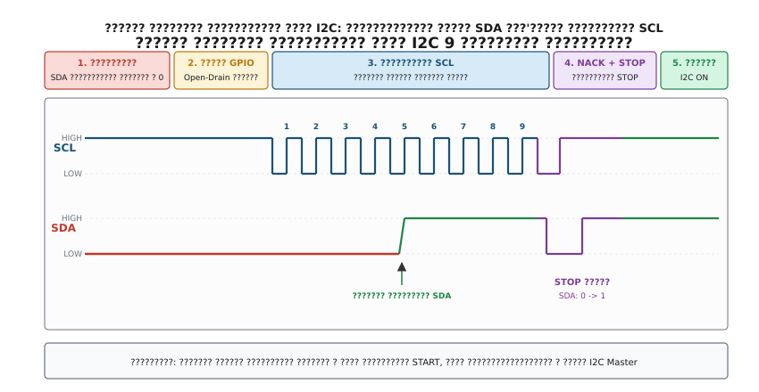

## ???????? ??????????? ???? I2C: ???????? 9 ???????? ?????????

???? ??????? ?????????? ?????????? ?????????? I2C ????????? ? ???????? ???? `SDA = 0` ??? ???????? ????? SCL, ????????? ???????? ?????????? ????? ??????????????? `I2C1->CR1 |= I2C_CR1_SWRST` ?? ????????? ??????? ????? ?????, ???????? ????? ??????? ?????????? ?????????? ??????????.

??? ??????????? ?????????????? ???? ?????????? ??????????????? ????????? **??????? ?????????? ???? (I2C Bus Recovery Routine)**, ?????? ?? ???????? ???'??? ???????? ?????????.


*?????? ???????? ??????????? ????????????? ????? SDA ?? ????????? ??????????? ??????? ? ????? GPIO Open-Drain, ????????? 9 ????????? SCL ?? ?????????? ???? NACK ? STOP.*

### ?????????? ???????? ????????? ???????????

1. **????????? ????????????? ????? I2C**. ???????? ?????? ??? `PE` (Peripheral Enable) ? ????????? ???????? `CR1`, ??? ?????????? ????????? ???????? ??????? I2C ??? ??????? ???????????????.
2. **???????????????? ??????? ? ????? GPIO Open-Drain**. ?????? ???????????????, ?? ???????????? ?????? SCL ?? SDA, ????????????? ? ?????????????? ??????? I2C ? ????? ????????? ??????? ?????????? ??????????? (General Purpose Output) ???? ????????? ???? (Open-Drain) ?? ??????????????? ???????????. ?????????? ???? ??????? ?????????????? ? ??????? ???????? ?????? (??????????? ???????).
3. **???????????? ?????????? ????? SDA**. ???????? ?????? ??????? ?????? ????? SDA ????? ??????? ??????? ????? `IDR` ????? GPIO:
   - ???? `SDA == 1` (HIGH), ????? ?? ???????????. ???????? ????? ???? ? ?????????? ???? ?????????? ??? ????????????? ??????. ????? ??????? ?? ????? 6 (????????? ????? STOP).
   - ???? `SDA == 0` (LOW), ??????? ??? ??????? ?????. ??????????? ???? ????????? ???????? ?????????.
4. **????????? ????? ???????? ????????? ?? ????? SCL**. ???????? ????????? ?????? ?? ?????? SCL ?? 9 ??????????? ??????????? ????????? ?? ??????????, ?? ???????????? ??????????? ????????? I2C ($100\,\text{kHz}$, ????? ?????? $10\,\mu\text{s}$: $5\,\mu\text{s}$ ??????? ??????, $5\,\mu\text{s}$ ??????? ??????):
   - ???????? SCL ? 0 (`GPIO_BSRR_BR`), ????????? ???????? $t_{\text{LOW}} \ge 4.7\,\mu\text{s}$.
   - ??????? SCL ? 1 (`GPIO_BSRR_BS`), ????????? ???????? $t_{\text{HIGH}} \ge 4.0\,\mu\text{s}$.
   - ??? ??? ???????? ????? SCL ??????? ???? ????? SDA.
   - **??????? ????**: ? ?????? ??????? ??????? SCL ??????? ??? ????????? ????????? ??? ?? ????? ???????????? 8-??????? ???????? ????????. ???????? ??????????? ??????? ?????????? ????? ????????? 8 ????? ???? 1 ??? ????????????? ACK, ??????? ??????????? ??????? ??? ???? ???????? ?? ?????? ??? 9 ??????. ?? ?????? ??????? ???????? ???????????? ?????, ??? ???????? ???? ???????? ?????????? ? ????? SDA ???????????? ?????????? ?? ???????? ????? $3.3\,\text{V}$.
   - ???? ?? ????????? ????? ??????? `SDA == 1`, ???? ?????????? ????? ??????? ?????????.
5. **????????? ????? NACK**. ?? 9-?? ????? ??????? ??????? ????? SDA ? ???????? ????? (HIGH). ?? ?????????? ???????? ??? ????? NACK (Not Acknowledge) ? ??????? ??? ??????? ????????? ??????, ?? ???????? ??????? ??? ????????? ????? ????????.
6. **????????? ?????????? ????? STOP**. ????? ??????????? ???????? ????? ?? ???? ?????? ??????? ?????'?????? ?????????? ???????? ????? ??????? STOP, ??? ???????? ??????? ???????? ???? ??????????? ?? ???? ????????? ? ???? ?????? (Bus Idle):
   - ??? ???????? ????? SCL ???????? ????? SDA ? 0.
   - ????????? ???????? $t_{\text{SU;STO}} \ge 4.0\,\mu\text{s}$.
   - ??????? ????? SDA ? 1 ??? ?????????? ???????? ????? SCL.
7. **???????? ???????? ?? ?????????? ????????? I2C**. ?????? ??????????????? ???????????? ? ????? ?????????????? ??????? I2C. ????????? ???????????? ?????? ?????????? ??????? ??????????? ???????? ????? ???????????? ???? `SWRST` ? ???????? `CR1` ? ????????? ?????????, ????? ???? ??????????????? ?????? ? ????????????? ????????? ?? ?????.

?????????? ????????? ?????????? ????????? ??????????? ???? I2C.

:::tabs
@tab C99
```c
#include <stdint.h>
#include <stdbool.h>
#include "stm32f4xx.h"

// ????????? ????????????? ???????? ?? ???? DWT
static void delay_us(uint32_t us) {
    uint32_t start = DWT->CYCCNT;
    uint32_t ticks = (uint32_t)(((uint64_t)us * SystemCoreClock) / 1000000ULL);
    while ((uint32_t)(DWT->CYCCNT - start) < ticks);
}

int i2c_bus_unlock_recovery(GPIO_TypeDef *scl_port, uint16_t scl_pin,
                            GPIO_TypeDef *sda_port, uint16_t sda_pin,
                            I2C_TypeDef *i2c) {
    // 1. ????????? ????????? ?????? I2C
    i2c->CR1 &= ~I2C_CR1_PE;

    // 2. ???????????? ?????? SCL ?? SDA ?? GPIO Open-Drain Output
    // ???????????? ?????? ?????? ? HIGH (??????????? ?????)
    scl_port->BSRR = (1U << scl_pin);
    sda_port->BSRR = (1U << sda_pin);

    // ???????????? ??????: Output Open-Drain, High Speed
    uint32_t pin_pos = scl_pin;
    scl_port->MODER &= ~(3U << (pin_pos * 2));
    scl_port->MODER |= (1U << (pin_pos * 2));  // General purpose output
    scl_port->OTYPER |= (1U << pin_pos);       // Open-Drain

    pin_pos = sda_pin;
    sda_port->MODER &= ~(3U << (pin_pos * 2));
    sda_port->MODER |= (1U << (pin_pos * 2));  // General purpose output
    sda_port->OTYPER |= (1U << pin_pos);       // Open-Drain

    delay_us(10);

    // 3. ????????? ?? 9 ???????? ?????????, ???? SDA ??????????? ?? 0
    bool sda_released = false;
    for (int i = 0; i < 9; i++) {
        if ((sda_port->IDR & (1U << sda_pin)) != 0) {
            sda_released = true;
            break;
        }

        // SCL LOW
        scl_port->BSRR = (1U << (scl_pin + 16));
        delay_us(5);

        // SCL HIGH
        scl_port->BSRR = (1U << scl_pin);
        delay_us(5);
    }

    if ((sda_port->IDR & (1U << sda_pin)) != 0) {
        sda_released = true;
    }

    // 4. ???????? ????? STOP: ??????? SDA 0 -> 1 ??? SCL = 1
    sda_port->BSRR = (1U << (sda_pin + 16)); // SDA LOW
    delay_us(5);
    scl_port->BSRR = (1U << scl_pin);        // SCL HIGH
    delay_us(5);
    sda_port->BSRR = (1U << sda_pin);        // SDA HIGH (STOP ?????)
    delay_us(10);

    // 5. ?????????? ?????? ? ????? ?????????????? ??????? I2C
    pin_pos = scl_pin;
    scl_port->MODER &= ~(3U << (pin_pos * 2));
    scl_port->MODER |= (2U << (pin_pos * 2));  // Alternate function
    pin_pos = sda_pin;
    sda_port->MODER &= ~(3U << (pin_pos * 2));
    sda_port->MODER |= (2U << (pin_pos * 2));  // Alternate function

    // 6. ????????? ???????? ????????????? ????? I2C
    i2c->CR1 |= I2C_CR1_SWRST;
    delay_us(5);
    i2c->CR1 &= ~I2C_CR1_SWRST;

    // ???????? I2C
    i2c->CR1 |= I2C_CR1_PE;

    return sda_released ? 0 : -1;
}
```
@tab C++20
```cpp
#include <cstdint>
#include <chrono>
#include <expected>
#include "stm32f4xx.h"

struct GpioPin {
    GPIO_TypeDef* port;
    uint8_t pin_index;

    void set_high() const noexcept { port->BSRR = (1U << pin_index); }
    void set_low() const noexcept { port->BSRR = (1U << (pin_index + 16)); }
    [[nodiscard]] bool read() const noexcept { return (port->IDR & (1U << pin_index)) != 0; }

    void configure_open_drain() const noexcept {
        port->MODER &= ~(3U << (pin_index * 2));
        port->MODER |= (1U << (pin_index * 2)); // Output
        port->OTYPER |= (1U << pin_index);      // Open-Drain
    }

    void configure_alternate_function() const noexcept {
        port->MODER &= ~(3U << (pin_index * 2));
        port->MODER |= (2U << (pin_index * 2)); // AF
    }
};

class I2cBusRecovery {
public:
    static std::expected<void, BusError> unlock(GpioPin scl, GpioPin sda, I2C_TypeDef* i2c) noexcept {
        i2c->CR1 &= ~I2C_CR1_PE; // ????????? ????????? I2C

        scl.set_high();
        sda.set_high();
        scl.configure_open_drain();
        sda.configure_open_drain();

        delay_us(10);

        bool sda_ok = false;
        for (int pulse = 0; pulse < 9; ++pulse) {
            if (sda.read()) {
                sda_ok = true;
                break;
            }
            scl.set_low();
            delay_us(5);
            scl.set_high();
            delay_us(5);
        }

        if (sda.read()) {
            sda_ok = true;
        }

        // ????????? ?????????? STOP ?????
        sda.set_low();
        delay_us(5);
        scl.set_high();
        delay_us(5);
        sda.set_high();
        delay_us(10);

        // ??????????? ?????????????? ???????
        scl.configure_alternate_function();
        sda.configure_alternate_function();

        // ???????? ??????????
        i2c->CR1 |= I2C_CR1_SWRST;
        delay_us(5);
        i2c->CR1 &= ~I2C_CR1_SWRST;
        i2c->CR1 |= I2C_CR1_PE;

        if (!sda_ok) {
            return std::unexpected(BusError::BusStuck);
        }
        return {};
    }

private:
    static void delay_us(uint32_t us) noexcept {
        const uint32_t start = DWT->CYCCNT;
        const uint32_t ticks = static_cast<uint32_t>((static_cast<uint64_t>(us) * SystemCoreClock) / 1'000'000ULL);
        while ((DWT->CYCCNT - start) < ticks);
    }
};
```
:::
