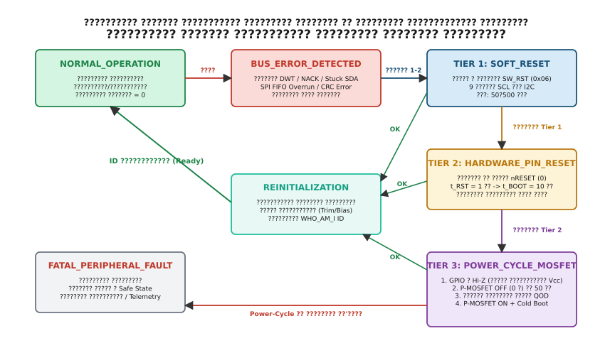

## ?????????? ????????? ???????? ????: ??? ??????????? ???????? ?? ???????? ????????

????????? 9 ???????? ????????? ??????? ??????? ???????? ?????????? ????? ??'????, ????? ???? ?? ?????? ????????? ?????? ????, ???? ? ????? ??????? ????????? ??????? ????, ?????? ????????????? ?????????? ??????? (PLL), ????? ???????????? ??? ??? ??????????? ????????? ???'??? ??????????????? ?????????.

??? ???????????? ???????????? ????????? ??????? ????????? ???????????? **????????? ??????????? ????????? ???????? (Three-Tier Reset Escalation Strategy)**.


*?????????? ??????? ??????? ?????? ????????????? ????????: ??? ??????????? ???????? ????????? ????????? ?? ?????????? ???????? nRESET ?? ??????? ?????????? ??????????? ???????? ??????????? MOSFET.*

????????? ????????? ?? ????????? ?????????? ??????: ??????? ???????? ?????????? ?????????? ? ??????? ????????? ?????? ???????????, ? ???? ? ???? ???? ?????????????? ?????????? ?? ????? ??????????? ??????.

### ?????? 1 (Tier 1): ????????? ???????? ????? ???????? (Soft-Reset)

?????? ?????? ??????? ??????? ? ???????????? ??????????? ?????????? ??????? ???????? ?? ???? I2C ??? SPI ??? ????? ??????? ???????? ?? ???????? ???????.

* **??????? General Call Soft-Reset ??? I2C**. ???????? I2C ???????? ????????????? ?????? ?????????? ??????? `0x00`. ???? ????? ?????? `0x00` ???????? ???? `0x06`, ??? ?????????? ????????, ?? ??????????? ?? ??????? (??????? ?????????? NXP, TI, ST), ?????'????? ??????????????? ???? ????????? ???????? ? ???????? ?? ?????????????.
* **?????????? ???????? Soft-Reset ?????????? ?????????**. ????????? ???????? ???????? ????? ????????? ??? ??????????? ???????? ? ?????? ? ???????? ????????? (?????????, ??? `SW_RESET = 0xB6` ? ???????? `RESET` ???????? Bosch BMP280/BME680, ??? ??? `BOOT` ? ???????? `CTRL_REG5` ?????????????? STMicroelectronics LIS3DH).

**????????**: ????????? ????????? (??? $50\,\mu\text{s}$ ?? $1\,\text{ms}$), ????? ??????????? ???????????? ?????????? ???????? ?? ????????, ?????????? ???????? ????? ???????? ?? ??? ????? ????.

**?????????**: ?????? 1 ????????? ????????????, ???? ? ???? ???????????? ???????????? ?????? ??'????, ?????????? ??????? ????? ??? ????????? ???????? ?????????, ???????? ??? ?????? ?? ????? ???????? ????? ?? ???????? ????????.

### ?????? 2 (Tier 2): ???????? ???????? ??????? ?????? nRESET

???? ????? 2?3 ????? ??????????? ???????? ??? ?? ?????????? ??? ???????? ?????????? ????????????? ???????? (`WHO_AM_I != EXPECTED_ID`), ??????? ?????????? ???????? ??????? ?????????? ???????? ????? ???????? ????? `nRESET` (NRST).

????? `nRESET` ????????????? ?? ???????? ?????? GPIO ???????????????, ????????????? ?? Push-Pull ?????. ?? ????????????? ????? ??????????? ? ???????? ????? $3.3\,\text{V}$.

1. ???????? ????????? ????? `nRESET` ?? ????????? ???? $0.0\,\text{V}$.
2. ???????????? ?????????? ???????? ???????? $t_{\text{RST}}$, ?????????????? ????????????? ????????? (Datasheet). ??? ????????? ????????? ?????????? ?????????? ????????? ??? $10\,\mu\text{s}$ ?? $1\,\text{ms}$.
3. ???????? ???????? ????? `nRESET` ? ??????? ?????? $3.3\,\text{V}$.
4. ???????????? ??? ?????? ?? ??????? ????? ????? ???????? $t_{\text{BOOT}}$ ??? $t_{\text{POR}}$ (Power-On Reset settling time). ? ??? ?????? ????????? ????? Power-On Reset ???? ?????? ????????? ???????????, ???????????? PLL, ?????? ???????? ????????????? ??????????? ? ??????????? ROM/OTP-???'??? ?? ?????????? ??????? ??????. ??????? ??? ?????????? ???? ??? ???????? ?????? ??? $500\,\mu\text{s}$ ?? $20\text{--}50\,\text{ms}$.

**????????**: ??????????? ??????????? ?????????????? ?????????? ???????? ???????? ????????? ? ??????????? ????, ?? ??????? ????????? ???????? ????????.

**?????????**: ??????? ????????? ???????? ???? GPIO ??? ??????? ????????????? ????. ?? ??????? ????????, ???? ??? ?????? ?????? ???????????? ????????? (CMOS Latch-up) ????? ?????????????? ???????????????? ?????? (ESD), ???? ????????? ????????? P-N-P-N ??????????? ????????? ? ????????? ???? ???????? ?? ????? ?? ??????? ?????? ???????.

### ?????? 3 (Tier 3): ????? ???????? ???????? ???????? ???? (Power-Cycle MOSFET)

???? ????????? ?????????? ??????????? ???????? ?? ?????????? ?????? nRESET, ???????? ??????? ????????? ? ????? ???????? ????????????? ????????????? ????? ? **Power-Cycle**.

????????? ???????? ???????????? ?? ????????? ???????? P-?????????? ????????? ??????????? (High-Side P-MOSFET) ??? ??????????????? ?????????? ???????? ????????? ???????? (Integrated Load Switch, ????????? Texas Instruments TPS22918, TPS22919).

#### ????????? ??????????? ???????? ????? ????????? ????? ??????? ESD (Phantom Back-Powering)

???????? ?????????? ?? ????????? ?????????? ???????? ??? ??? ?????????? ????? Power-Cycle ? ?????? ???????? MOSFET ???????? ??? ????? ????? ????? ??'????.

????? ???????? ????/????? ???????????? ?????????? ??????? ????????? ????? ??????? ??? ???????????????? ???????? (ESD Protection Circuitry), ?? ??????????? ? ???? ????????? ?????????? ???????? ??????: ???????? (??? ?????? ?????? ?? GND) ? ????????? (??? ?????? ?????? ?? ????? ???????? $V_{\text{DD}}$ ????).

???? ???????? P-MOSFET ???????? ???? ???????? ($V_{\text{SENSOR}} = 0\,\text{V}$), ??? ?????????????? ????????? ?????????? ???? ? ???? ??????? ????? (SCL, SDA, CS, MOSI, SCK) ? ???????? ????? $3.3\,\text{V}$ ?? ??????? ??????????????? ????????? ??? ????????? Push-Pull ????????, ??????? ????? **??????????? ?????????? ???????? (Phantom Back-Powering)**:

1. ??????? ? ?????? ??????????????? $3.3\,\text{V}$ ?????????? ?? ????? ????????? ????????? ????? $D_{\text{ESD\_TOP}}$ ????.
2. ???? ????????????? ??? ??????? ???????? $V_{\text{F}} \approx 0.6\,\text{V}$.
3. ????? ?? ?????? ????? ???? ????? ???? ESD ????????????? ? ????????? ???? ???????? $V_{\text{DD\_CHIP}}$ ???????, ?????????? ??????????? ???????????? ???? ?? ???????:

$$V_{\text{DD\_CHIP}} = V_{\text{MCU\_IO}} - V_{\text{F}} = 3.3\,\text{V} - 0.6\,\text{V} = 2.7\,\text{V}$$

? ?????????? ?????? **??????? ?? ???????????????**. ??? ????????? ????????????? ? ?????????? ?????? ???????? ??????? ($2.7\,\text{V}$ ??????? $3.3\,\text{V}$), ???? ????????? ????? POR ?? ??????????, ???? ???????????? ????????? ?? ??????????, ? ???????? ???? ?????????????? ????? ?????????? ????????????????? ?????? (?? 20?50 ??), ?? ? ????? ?????????? ?? ???? ????????? ?????????? ?? ??????.

#### ??????? ????????? ????????? ?????????? ???????? ????????

??? ??????????? ??????? ????? ????????????? ????????????? ????, ????????? Power-Cycle ??????? ?????? ????????????? ?????? ?????????:

1. **???????? ?????????? (Tri-state / Hi-Z)**:
   - ????????? ????????? ??? ?????? ???????????????, ?????????? ?? ???????????? ???? (SCL, SDA, MOSI, MISO, SCK, CS, nRESET, INT), ? ????? ?????????? ?????? ???????? ????????? (`MODER = 0b11`, Analog Mode).
   - ???????? ??? ????????? ????????????? ????????? ????????? (`PUPDR = 0b00`, No Pull-up/Pull-down).
   - ???? ?? ????? ??????????? ???????? ????????????? ????????? ???? I2C, ???? ???????? ??? ???? ?????????? ?? ??????????? ???? $V_{\text{SENSOR}}$, ? ?? ?? ????????? ???? $V_{\text{DD\_3V3}}$.
2. **?????????? ???????? ????? (Power Cut)**:
   - ??????? ?????????? P-MOSFET (?????? 0 ?? ?????? N-?????????? ??????????? ????????????? ??? ???????? Load Switch).
3. **?????????? ?????? ?????????? ??????? (Active Discharge)**:
   - ??????????? ???????????? ?? ???? ???????? ????????? ($C_{\text{decoupling}} = 10\text{--}47\,\mu\text{F}$) ????? ??????????? ?? ??????? ????? ?? $0.1\,\text{V}$.
   - ???? ???????????? ????????????, ????? ?????????? ????? ????? ?? ????, ? ?????? ????? ?????? ?????? ???? ??????? ???????. ???? ?? ?????????? ???? ???????????? ??????????? ????????? ???????? $R_{\text{discharge}} \approx 1\,\text{k}\Omega$ ??? ?????????????? Load Switch ? ???????? ???????? ??????? ?????? (Quick Output Discharge, QOD).
   - ???????? ???? ??????? ????????? $\tau = R_{\text{discharge}} C_{\text{decoupling}} = 1000\,\Omega \times 10\cdot 10^{-6}\,\text{F} = 10\,\text{ms}$. ??? ????????????? ???????? ??????? ????? $1\%$ ??? ???????? ??? ????????? ?????????? ????? ??????? ????????? $t_{\text{OFF}} \ge 5\tau \approx 50\,\text{ms}$.
4. **?????? ???????? ?? ??? ?????????? (Power-Up & Slew Rate)**:
   - ???????? ?????????? P-MOSFET.
   - ????????? ??? ???????????? ??????? ???????? $t_{\text{POWER\_UP}} \approx 10\text{--}20\,\text{ms}$, ?????????? ??? ?????????? ?????????? ???????? ? ???????? LDO-?????????????? ?? ?????? ??????????? ?????????????.
5. **??????????? ???????????? GPIO ?? ??????? ????????????? (Cold Boot)**:
   - ????????????????? ?????? ??????????????? ? ?????? ?????? (AF ??? SPI/I2C, Output ??? CS/nRESET).
   - ???????? ????? ???????? ????????????? ???? "? ??????? ??????", ????????? ?????? ????? ??????????????? ?????????, ??????????? ?? ??????? ??????.

?????????? ????????? ?????????? ????????? ????????? ???????? ?? C99 ?? C++20.

:::tabs
@tab C99
```c
#include <stdint.h>
#include <stdbool.h>
#include "stm32f4xx.h"

typedef enum {
    RESET_TIER_1_SOFT = 1,
    RESET_TIER_2_PIN  = 2,
    RESET_TIER_3_PWR  = 3
} reset_tier_t;

typedef struct {
    GPIO_TypeDef *pwr_port;
    uint16_t pwr_pin;       // ????????? MOSFET (1 = ON, 0 = OFF)
    GPIO_TypeDef *nrst_port;
    uint16_t nrst_pin;      // ????? nRESET
    GPIO_TypeDef *scl_port;
    uint16_t scl_pin;
    GPIO_TypeDef *sda_port;
    uint16_t sda_pin;
    uint8_t fault_count;
} chip_power_controller_t;

static void delay_ms(uint32_t ms) {
    for (uint32_t i = 0; i < ms; i++) {
        uint32_t start = DWT->CYCCNT;
        uint32_t ticks = SystemCoreClock / 1000U;
        while ((uint32_t)(DWT->CYCCNT - start) < ticks);
    }
}

void chip_power_cycle(chip_power_controller_t *ctrl) {
    // 1. ?????????? ??? ???'????? ?????? GPIO ? Hi-Z (Analog Mode)
    ctrl->scl_port->MODER |= (3U << (ctrl->scl_pin * 2));
    ctrl->scl_port->PUPDR &= ~(3U << (ctrl->scl_pin * 2));

    ctrl->sda_port->MODER |= (3U << (ctrl->sda_pin * 2));
    ctrl->sda_port->PUPDR &= ~(3U << (ctrl->sda_pin * 2));

    if (ctrl->nrst_port) {
        ctrl->nrst_port->MODER |= (3U << (ctrl->nrst_pin * 2));
        ctrl->nrst_port->PUPDR &= ~(3U << (ctrl->nrst_pin * 2));
    }

    // 2. ???????? ???????? (MOSFET OFF)
    ctrl->pwr_port->BSRR = (1U << (ctrl->pwr_pin + 16));

    // 3. ??????? ??????? ??????? ???????? (50 ??)
    delay_ms(50);

    // 4. ??????? ???????? (MOSFET ON)
    ctrl->pwr_port->BSRR = (1U << ctrl->pwr_pin);

    // 5. ???????? ???????????? ??????? ???????? ?? ???????????? POR (20 ??)
    delay_ms(20);

    // 6. ??????????? nRESET ? ??????? ??????
    if (ctrl->nrst_port) {
        ctrl->nrst_port->MODER &= ~(3U << (ctrl->nrst_pin * 2));
        ctrl->nrst_port->MODER |= (1U << (ctrl->nrst_pin * 2)); // Output
        ctrl->nrst_port->BSRR = (1U << ctrl->nrst_pin);         // High
    }
}
```
@tab C++20
```cpp
#include <cstdint>
#include <chrono>
#include <array>
#include "stm32f4xx.h"

class PowerCycleController {
public:
    struct Config {
        GpioPin pwr_switch;
        GpioPin nrst_pin;
        std::array<GpioPin, 2> bus_pins; // SCL, SDA ??? SCK, MOSI
    };

    explicit PowerCycleController(Config config) noexcept : cfg_{config} {}

    void execute_power_cycle() const noexcept {
        // 1. ???????? ????: ??????????? ???? ????? ? Hi-Z (Analog Mode)
        for (const auto& pin : cfg_.bus_pins) {
            set_analog_hiz(pin);
        }
        if (cfg_.nrst_pin.port) {
            set_analog_hiz(cfg_.nrst_pin);
        }

        // 2. ????????? ???????? (MOSFET OFF)
        cfg_.pwr_switch.set_low();

        // 3. ????? ??? ??????? ??????????? ?????????????
        delay_ms(50);

        // 4. ???????? ???????? (MOSFET ON)
        cfg_.pwr_switch.set_high();

        // 5. ??? ?????????? ?????????? ???????????? ??????? ????
        delay_ms(20);

        // 6. ??????????? ?????? nRESET ? HIGH
        if (cfg_.nrst_pin.port) {
            cfg_.nrst_pin.set_high();
            cfg_.nrst_pin.port->MODER &= ~(3U << (cfg_.nrst_pin.pin_index * 2));
            cfg_.nrst_pin.port->MODER |= (1U << (cfg_.nrst_pin.pin_index * 2)); // Output
        }
    }

private:
    Config cfg_;

    static void set_analog_hiz(const GpioPin& pin) noexcept {
        pin.port->MODER |= (3U << (pin.pin_index * 2));       // Analog mode
        pin.port->PUPDR &= ~(3U << (pin.pin_index * 2));      // No pull
    }

    static void delay_ms(uint32_t ms) noexcept {
        for (uint32_t i = 0; i < ms; ++i) {
            const uint32_t start = DWT->CYCCNT;
            const uint32_t ticks = SystemCoreClock / 1000U;
            while ((DWT->CYCCNT - start) < ticks);
        }
    }
};
```
:::
